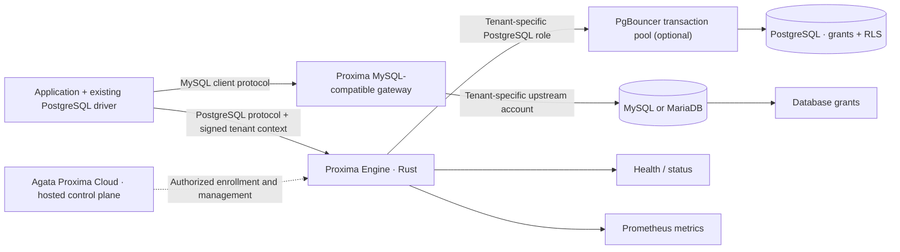

<p align="center">
  
</p>

<h1 align="center">Agata Proxima · Proxima Engine</h1>
<p align="center"><strong>Multi-database tenant isolation, enforced at the database connection boundary.</strong></p>
<p align="center">Proxima Engine is the open-source Rust data plane for multi-database tenant security. It supports PostgreSQL, CockroachDB 25.2+, MySQL, MariaDB, MongoDB 8, Redis RESP2, SQLite tenant-file isolation, Oracle schema-per-tenant isolation, SQL Server's native database-per-tenant profile, DynamoDB IAM `LeadingKeys` policies, Cassandra keyspace-per-tenant roles, and separate Elasticsearch/OpenSearch native-role policy helpers. Each database uses an isolation model appropriate to its architecture; these integrations are not presented as one interchangeable database protocol.</p>

<p align="center">
  <a href="https://github.com/Proxima-Engine/proxima-engine/actions/workflows/ci.yml">Continuous integration</a> ·
  <a href="LICENSE">MIT license for covered Engine source</a> ·
  <a href="https://agataproxima.com">Website</a> ·
  <a href="https://discord.gg/xsYSuDMzg">Discord</a> ·
  <a href="https://x.com/Worldtwins25">X</a> ·
  <a href="https://www.linkedin.com/company/agata-proxima/">LinkedIn</a>
</p>

**Start:** [What is Agata Proxima?](#what-is-agata-proxima) · [Launch evaluation](docs/LAUNCH.md) · [Quickstart](docs/QUICKSTART.md) · [Local developer mode](docs/LOCAL_DEVELOPMENT.md) · [Engine CLI](docs/CLI.md) · [Documentation index](docs/README.md)

**Technical guides:** [Architecture](docs/ARCHITECTURE.md) · [Phase One Cloud-to-Engine runtime](docs/CLOUD_ENGINE_RUNTIME_LIFECYCLE.md) · [Tenant isolation](docs/TENANT_ISOLATION.md) · [Driver integrations](docs/INTEGRATIONS.md) · [API and metrics](docs/API.md) · [Security](docs/SECURITY.md) · [Deployment](docs/DEPLOYMENT.md) · [Verification](docs/VERIFICATION.md)


## Watch: Zero-Trust Tenant Isolation in Action — PostgreSQL

**Proxima Engine enforces tenant identity at the PostgreSQL proxy boundary.** This recorded engineering demonstration shows the Engine under real database and connection-pooling conditions.

The walkthrough covers PgBouncer transaction pooling, deliberately misconfigured Row-Level Security scenarios, 1,000 distinct tenant identities with up to 50 concurrent clients, signed-token validation, and Engine recovery.

**Watch the full demonstration:**

https://github.com/user-attachments/assets/bca488eb-829c-4672-bbe9-b25878e5401c

**Read the engineering case study:** [Tenant isolation, PgBouncer pooling, 1,000-identity validation, RLS scenarios, and Engine recovery](docs/ENGINEERING_CASE_STUDY.md) · [Recorded validation evidence](evidence/engineering-validation-2026-11-09.md)

---

## What is Agata Proxima?

Agata Proxima provides multi-database security infrastructure for applications that serve multiple customers from shared database environments. Proxima Engine enforces tenant identity in the database connection path. PostgreSQL and CockroachDB use the PostgreSQL wire gateway with database-native roles and row-level security; MySQL and MariaDB use authenticated client identities bound to tenant-specific upstream accounts and databases; MongoDB uses a restricted OP_MSG gateway with database-per-tenant isolation.

The product has two cooperating components:

### Proxima Engine — public, open-source data plane

Proxima Engine is a Rust service that sits between an application's existing database driver and its database server. It provides a PostgreSQL protocol listener, a separate MySQL-compatible protocol listener, a restricted MongoDB OP_MSG listener, and a restricted Redis RESP2 listener. CockroachDB 25.2+ uses the PostgreSQL wire listener. SQL Server is documented as a native database-per-tenant security profile, not a Proxima TDS proxy. Applications keep their existing database drivers and connect to the matching Engine endpoint.

The Engine provides:

- **PostgreSQL signed-context enforcement.** Validates tenant tokens using HMAC-SHA256, including token format, tenant identifier, expiry and signature. Missing or invalid context is rejected when tenant enforcement is enabled.
- **PostgreSQL role routing.** Maps the verified tenant identity to its dedicated upstream PostgreSQL role and relies on PostgreSQL grants and Row-Level Security (RLS).
- **MySQL and MariaDB session enforcement.** Authenticates each client against a protected identity registry, binds the session to one tenant principal, validates the assigned upstream database and uses a dedicated least-privilege upstream account. The MySQL-compatible gateway has separate MySQL and MariaDB integration suites.
- **CockroachDB compatibility.** Reuses the PostgreSQL wire gateway and requires CockroachDB-native forced row-level security, tenant-scoped roles, and least-privilege grants. The compatibility profile is verified against CockroachDB 25.2.
- **MongoDB restricted gateway.** Provides a separate OP_MSG gateway with SCRAM-SHA-256 authentication, TLS, database-per-tenant identity mapping, a narrow command allowlist, and tenant-bound sessions. Unsupported commands, transactions, sharded topologies, compression, and full MongoDB feature parity are not claimed.
- **Redis restricted gateway (preview).** Adds a separate RESP2 TLS listener, client identity registry, immutable tenant sessions, key namespace rewriting and per-tenant upstream Redis ACL users. RESP3, transactions, scripting, Pub/Sub, key scans and broad command compatibility are deliberately unsupported; the CI acceptance suite is the release gate.
- **SQL Server native tenant profile (preview).** Uses a dedicated SQL Server database and least-privilege login per tenant so applications do not include tenant IDs in SQL. It is not a Proxima TDS listener or shared-database RLS implementation.
- **SQLite tenant storage.** Uses a separate embedded SQLite database file per tenant, validated tenant identifiers, canonicalized storage paths, symlink rejection, owner-only Unix permissions, SQLite NOFOLLOW, WAL mode, and hardened connection pragmas. SQLite has no server-side roles; the trusted application process owns tenant-to-file resolution.
- **Oracle schema tenancy.** Uses a dedicated Oracle schema owner per tenant, a bounded tablespace quota, narrowly scoped object-creation privileges, and no DBA or cross-schema ANY grants. Applications connect with the tenant-specific Oracle identity.
- **DynamoDB tenant authorization.** Generates tenant-specific AWS IAM identity policies scoped to an exact table ARN and authenticated tenant partition key through `dynamodb:LeadingKeys`. Scan, PartiQL, transactions and table administration are not granted. AWS IAM enforcement requires a real AWS-account acceptance test; DynamoDB Local cannot prove IAM isolation.
- **Cassandra tenant isolation.** Provides a keyspace-per-tenant provisioning profile with a dedicated login role and SELECT/MODIFY-only grants. It relies on Cassandra-native authentication and authorization; it is not a CQL wire-protocol proxy.
- **Elasticsearch / OpenSearch tenant policy helpers.** Build provider-specific tenant-scoped role descriptors with index namespaces, document-level security queries and field-level allowlists. Each distribution retains its own compatibility and acceptance requirements.
- **Protocol and connection controls.** Applies protocol-specific startup handling, connection limits, upstream timeouts and configured TLS requirements.
- **PostgreSQL security operations.** Includes the peer-scoped violation breaker, short-lived break-glass tokens with replay protection and the local signed attestation ledger.
- **PostgreSQL operational visibility.** Exposes the Engine's local health/status routes and Prometheus metrics.
- **Developer tooling.** Includes a Python local-development CLI, local identity bootstrap, signed PostgreSQL tenant-token generation, PostgreSQL driver examples, separate PostgreSQL, MySQL, MariaDB, CockroachDB, MongoDB, Redis, SQL Server, SQLite, Oracle, DynamoDB, Cassandra, and Elasticsearch/OpenSearch guides, customer installers and database-specific integration tests.

### Agata Proxima Cloud — hosted management product

Agata Proxima Cloud is the separate hosted control plane for organization workflows, teams, plans, billing, registered nodes, and hosted management. It coordinates authorized Engine nodes while database traffic remains in the customer environment.

The Cloud application and its private source are separate from this public Engine repository. The MIT license in this repository applies to the material covered by its license; it does not grant access to the hosted application's source code or hosted account features.

## How the request path works



Proxima Engine works alongside existing database deployments and drivers. PostgreSQL and CockroachDB sessions use the PostgreSQL wire listener, tenant-scoped roles and database-native RLS. MySQL and MariaDB sessions authenticate through the MySQL-compatible listener and remain bound to the tenant's assigned database and least-privilege upstream account. MongoDB sessions use the restricted OP_MSG gateway and a tenant-specific database identity. Redis preview sessions use the RESP2 gateway and tenant key namespaces backed by Redis ACLs. SQL Server preview deployments use distinct database logins and databases per tenant. Application authentication and organization membership checks remain in the trusted application backend.

## Database guides — separate setup for each engine

Each database has its own implementation guide, setup sequence, configuration, compatibility notes and verification instructions. PostgreSQL and CockroachDB share a wire-protocol family while retaining their respective database-native security profiles. MySQL and MariaDB have separate guides and acceptance suites. MongoDB has a restricted gateway profile with explicitly documented feature limits. Redis, SQL Server, SQLite, Oracle, DynamoDB, Cassandra and Elasticsearch/OpenSearch use provider-native security boundaries where appropriate; catalog and helper code do not imply that all are released gateways or fully provisioned Cloud integrations.

| Database | Start here | Deep-dive documentation |
|---|---|---|
| **PostgreSQL** | [PostgreSQL quickstart](docs/QUICKSTART.md) | [PostgreSQL documentation hub](docs/POSTGRESQL.md) · [Tenant isolation and RLS](docs/TENANT_ISOLATION.md) · [Driver integrations](docs/INTEGRATIONS.md) · [PgBouncer and verification](docs/VERIFICATION.md) |
| **MySQL** | [MySQL gateway guide](docs/MYSQL.md) | [Client authentication](docs/MYSQL_GATEWAY_AUTH.md) · [MySQL integration test](crates/proxima-engine/tests/mysql_gateway_integration.rs) |
| **MariaDB** | [MariaDB gateway guide](docs/MARIADB.md) | [Client authentication](docs/MYSQL_GATEWAY_AUTH.md) · [MariaDB integration test](crates/proxima-engine/tests/mariadb_gateway_integration.rs) |
| **CockroachDB 25.2+** | [Compatibility profile](docs/COCKROACHDB_COMPATIBILITY.md) | [Real CockroachDB tenant-isolation acceptance script](scripts/test-cockroachdb-tenant-isolation-ci.sh) |
| **MongoDB 8** | [Restricted gateway guide](docs/MONGODB_TENANT_ISOLATION.md) | [MongoDB gateway source](crates/proxima-engine/src/mongodb_gateway.rs) · [Real MongoDB tenant-isolation acceptance test](crates/proxima-engine/tests/mongodb_tenant_isolation.rs) |
| **Redis 7.4+ (preview)** | [Redis tenant gateway](docs/REDIS_TENANT_GATEWAY.md) | [RESP2 policy source](crates/proxima-engine/src/redis_protocol.rs) · [TLS gateway source](crates/proxima-engine/src/redis_gateway.rs) · [Real Redis acceptance script](scripts/test-redis-tenant-gateway-ci.sh) |
| **SQL Server 2022 (native profile preview)** | [Native tenant isolation](docs/SQLSERVER_NATIVE_TENANCY.md) | [Two-tenant provisioning fixture](scripts/sqlserver-provision-two-tenants.sql) · [Real SQL Server acceptance script](scripts/test-sqlserver-tenant-isolation-ci.sh) · No Proxima TDS proxy |
| **SQLite** | [Tenant isolation](docs/SQLITE_TENANCY.md) | Embedded database-file-per-tenant storage with path validation and owner-only permissions |
| **Oracle Database** | [Tenant isolation](docs/ORACLE_TENANCY.md) | Schema-per-tenant with dedicated Oracle users, bounded quota and least-privilege grants |
| **DynamoDB** | [Tenant isolation](docs/DYNAMODB_TENANCY.md) | AWS-native IAM policy using exact table ARN and `dynamodb:LeadingKeys`; real AWS IAM acceptance required |
| **Apache Cassandra 5** | [Tenant isolation](docs/CASSANDRA_TENANCY.md) | Native keyspace-per-tenant authentication and authorization; not a CQL proxy |
| **Elasticsearch / OpenSearch** | [Tenant isolation](docs/ELASTICSEARCH_TENANCY.md) | Separate native role descriptor helpers and independent real-cluster acceptance scripts; DLS/FLS are distribution/version/license-dependent; not Proxima wire gateways |

### What is a database gateway?

A database gateway is a protocol-aware network service between an application and its database. The application continues using its normal database driver. The driver connects to the matching Proxima listener; Proxima authenticates the connection, binds it to one tenant identity and forwards it to the assigned upstream database using that tenant's credentials.

The gateway does not replace PostgreSQL, CockroachDB, MySQL, MariaDB or MongoDB. It does not turn the databases into one database engine, and it does not make their security features interchangeable. PostgreSQL and CockroachDB use the PostgreSQL wire listener with their own native roles and RLS behavior. MySQL and MariaDB use the MySQL-compatible listener, tenant-specific upstream accounts, database grants and SQL admission controls. MongoDB uses a separate restricted OP_MSG gateway and MongoDB RBAC. Redis preview uses a RESP2 gateway, command allowlisting, tenant key namespaces and upstream ACL users. SQL Server preview uses native database-per-tenant logins and permissions; it is not a Proxima wire-protocol gateway.

### PostgreSQL

PostgreSQL is a first-class database integration with its own walkthrough, local Compose stack, PgBouncer transaction pooling, signed tenant context, tenant-role provisioning, Row-Level Security, driver examples, deployment, verification and engineering demonstration.

Start with [the PostgreSQL quickstart](docs/QUICKSTART.md), then complete [tenant isolation](docs/TENANT_ISOLATION.md) and [verification](docs/VERIFICATION.md).

### MySQL

The MySQL guide covers the MySQL-compatible listener, client authentication, tenant identity registry, tenant database and upstream-account provisioning, SQL admission, prepared statements, connection behavior, troubleshooting and its own integration suite.

Start with [the dedicated MySQL guide](docs/MYSQL.md). The repository's CI currently tests against MySQL 8.0; that is the recorded CI compatibility target, not the product's database name or a blanket statement about every MySQL release.

### MariaDB

The MariaDB guide covers the MariaDB upstream service, tenant database and account provisioning, client authentication, identity registry, SQL admission, prepared statements, troubleshooting and its own integration suite.

Start with [the dedicated MariaDB guide](docs/MARIADB.md). The repository's CI currently tests against MariaDB 11.4. MariaDB is documented and tested independently from MySQL even though both use the same MySQL-compatible client listener.

### CockroachDB

CockroachDB 25.2+ uses the PostgreSQL wire-protocol gateway. Tenant isolation depends on CockroachDB-native forced RLS, tenant-scoped roles and least-privilege grants; PostgreSQL-specific assumptions are not silently carried over. The CI acceptance test provisions CockroachDB 25.2 and verifies cross-tenant read and write denial. See the [CockroachDB compatibility profile](docs/COCKROACHDB_COMPATIBILITY.md).

### MongoDB

MongoDB 8 is supported through a separate, restricted OP_MSG gateway. The profile uses SCRAM-SHA-256, client TLS, database-per-tenant identity mapping and least-privilege MongoDB RBAC. The gateway denies commands and features outside its documented allowlist; transactions, sharded topologies, compression and general MongoDB feature parity are not supported. See [MongoDB tenant isolation](docs/MONGODB_TENANT_ISOLATION.md).

## Developer tools, SDKs and downloads

The Engine repository includes a Python local-development CLI for creating local node identity, generating signed tenant test tokens and inspecting local Engine health. It is separate from the downloadable Cloud API CLI on the website.

For Cloud API integration, the website provides a standalone Node.js CLI archive and an integration starter kit containing a server-side JavaScript API client, Node.js examples, shell and PowerShell smoke scripts, webhook receiver example, Supabase and Firebase integration patterns, GitHub Actions and Vercel templates, Terraform check examples and a ChatGPT/MCP server example.

- [Developer downloads](https://agataproxima.com/developers/downloads)
- [Standalone Cloud API CLI](https://agataproxima.com/developers/cli)
- [JavaScript API client guide](https://agataproxima.com/developers/sdks)
- [Integration catalog](https://agataproxima.com/developers/integrations)
- [Starter-kit inventory](https://github.com/Agata-Proxima/Agata-proxima/blob/main/download-kit/README.md)

The JavaScript API client is bundled source code, not a published npm package. The Terraform material is an integration/check example, not a dedicated Terraform provider. Proxima database traffic uses the existing native database drivers; a separate Proxima SQL-driver SDK is not required.

## Cloud-managed database configuration

Agata Proxima Cloud manages organization-scoped database targets and assignments for enrolled Proxima Engine nodes. Each assignment binds a database target, provider, endpoint, tenant bindings, configuration revision and credential revision to an authorized node.

The Engine authenticates configuration pulls with its enrolled node identity. Cloud returns a node- and organization-bound signed configuration bundle with AES-256-GCM credential envelopes. The Engine verifies the bundle and envelope bindings, decrypts provider credentials in memory, validates the assignment and reconciles the desired revision with its local runtime.

The runtime lifecycle includes durable assignment state, provider-specific configuration preparation, supervised gateway activation where the provider uses a gateway process, listener readiness, authenticated upstream health checks and a signed acknowledgement. Cloud records the applied revision only after the Engine reports the matching assignment and revision with a successful runtime-health result. Failed activation is recorded with a bounded error code; stale or mismatched acknowledgements do not advance the applied revision.

The Engine keeps desired and applied revisions distinct. Assignment identity and revision rollback are validated locally, runtime state is persisted atomically, and revocation stops the assignment-owned process and clears its applied marker. Provider-specific identity and authorization controls remain native to each database.

The 12 integrations use different security and runtime models. PostgreSQL and CockroachDB use the PostgreSQL-wire Engine runtime; MySQL and MariaDB use the MySQL-compatible gateway; MongoDB and Redis use their own protocol gateways; SQL Server, SQLite, Oracle, DynamoDB, Cassandra, Elasticsearch and OpenSearch use their documented native, file or provider-API security boundaries. The lifecycle does not treat these providers as interchangeable protocols.

See the [Cloud-to-Engine runtime lifecycle reference](docs/CLOUD_ENGINE_RUNTIME_LIFECYCLE.md), [provider guides](docs/README.md), and [verification guide](docs/VERIFICATION.md).

---

## PostgreSQL quickstart

Requirements: Git and Docker with Compose.

```bash
git clone https://github.com/Proxima-Engine/proxima-engine.git
cd proxima-engine
docker compose -f compose.dev.yaml up --build -d
```

The local profile starts PostgreSQL, PgBouncer in transaction-pooling mode, and Proxima Engine. Check the local listeners:

```bash
curl -fsS http://127.0.0.1:9090/healthz
curl -fsS http://127.0.0.1:9080/api/status
```

Windows PowerShell:

```powershell
Invoke-RestMethod http://127.0.0.1:9090/healthz
Invoke-RestMethod http://127.0.0.1:9080/api/status
```

Then follow the [Quickstart](docs/QUICKSTART.md) to create a table, send a real SQL query through the Engine and PgBouncer, inspect metrics, and stop the local stack. The Compose profile uses disposable local credentials and synthetic data.

## Verify tenant isolation

The repository includes PostgreSQL-backed tenant tests and a dedicated [PgBouncer tenant-pool integration test](scripts/test-pgbouncer-pooling.sh), which is run by GitHub Actions.

The verification path covers PostgreSQL 17, MySQL 8.0, MariaDB 11.4, CockroachDB 25.2, MongoDB 8, the SQL Server native tenant profile, Redis RESP2 gateway, Docker image build, and PgBouncer tenant-pool isolation:

1. Tenant A authenticates and reads only Tenant A's row.
2. Tenant B authenticates and reads only Tenant B's row.
3. Cross-tenant reads return zero visible rows.
4. Cross-tenant writes are rejected by PostgreSQL RLS.
5. Missing or invalid signed tenant context is rejected when enforcement is enabled.
6. Five sequential connections per tenant reuse that tenant role's backend PID, while the two tenant roles use separate backend PIDs through PgBouncer transaction pooling.

See [Tenant isolation](docs/TENANT_ISOLATION.md), [Verification](docs/VERIFICATION.md), and the [recorded PgBouncer transaction-pooling evidence](evidence/pgbouncer-transaction-pooling.txt).

The customer Compose definition includes separate opt-in `mysql`, `mongodb` and `redis` gateway profiles. The MongoDB profile requires a TLS certificate/key, an upstream CA, a tenant identity registry and an upstream MongoDB address; see [MongoDB tenant isolation](docs/MONGODB_TENANT_ISOLATION.md) before enabling it.

## Documentation

| Guide | Purpose |
|---|---|
| [PostgreSQL quickstart](docs/QUICKSTART.md) | Start the local stack, query PostgreSQL through the Engine and inspect metrics |
| [Local developer mode](docs/LOCAL_DEVELOPMENT.md) | Generate local node identity and signed tenant test tokens |
| [Engine CLI](docs/CLI.md) | Bootstrap, token generation, diagnostics, and local status commands |
| [Architecture](docs/ARCHITECTURE.md) | Request lifecycle, tenant context, source map, and control-plane boundary |
| [Configuration](docs/CONFIGURATION.md) | Environment variables, defaults, and validation |
| [Tenant isolation](docs/TENANT_ISOLATION.md) | PostgreSQL roles, RLS policies, signed context, and test results |
| [Driver integrations](docs/INTEGRATIONS.md) | PostgreSQL connection examples for psql, Node.js, Python, and Rust |
| [MySQL gateway](docs/MYSQL.md) | Dedicated MySQL upstream setup, identity registry, tenant accounts, client authentication and integration verification |
| [MariaDB gateway](docs/MARIADB.md) | Dedicated MariaDB upstream setup, identity registry, tenant accounts, client authentication and integration verification |
| [CockroachDB compatibility](docs/COCKROACHDB_COMPATIBILITY.md) | PostgreSQL-wire integration, CockroachDB 25.2+ RLS, tenant roles and retry semantics |
| [MongoDB tenant isolation](docs/MONGODB_TENANT_ISOLATION.md) | Restricted MongoDB 8 OP_MSG gateway, SCRAM-SHA-256, database-per-tenant isolation and unsupported features |
| [MySQL client authentication](docs/MYSQL_GATEWAY_AUTH.md) | Supported MySQL-compatible client verifier formats and authentication behavior |
| [Database gateways in Cloud](docs/CLOUD_CONTROL_PLANE.md) | Current PostgreSQL Cloud boundary and the planned multi-database resource model |
| [API reference](docs/API.md) | PostgreSQL endpoint, health/status routes, and Prometheus metrics |
| [Node enrollment](docs/NODE_ENROLLMENT.md) | Engine-side node identity and enrollment contract |
| [Deployment](docs/DEPLOYMENT.md) | Container build, TLS, networking, persistence, and deployment configuration |
| [Operations](docs/OPERATIONS.md) | Health checks, logs, monitoring, recovery, and troubleshooting |
| [Engineering case study](docs/ENGINEERING_CASE_STUDY.md) | PostgreSQL tenant isolation, RLS, PgBouncer, concurrency, authentication and recovery results |
| [Verification](docs/VERIFICATION.md) | Rust tests, PostgreSQL verification, MySQL and MariaDB integration suites, CI and evidence review |
| [Security model](docs/SECURITY.md) | Implemented controls and the configuration required to operate them |
| [Developer security walkthrough](docs/DEVELOPER_SECURITY_DEMO.md) | Reproduce positive and negative tenant-access scenarios |
| [Cloud control plane](docs/CLOUD_CONTROL_PLANE.md) | Hosted product and self-managed Engine responsibilities |
| [Plans and billing](docs/BILLING.md) | Hosted plan and checkout information |
| [Support](docs/SUPPORT.md) | Technical support, issue reporting, and contact routes |
| [Contributing](CONTRIBUTING.md) | Development setup and pull-request process |
| [Security policy](SECURITY.md) | Private vulnerability reporting |
| [Code of Conduct](CODE_OF_CONDUCT.md) | Community participation standards |
| [Copyright and brand](COPYRIGHT.md) | Source-license and brand-asset boundaries |
| [Open-source scope](docs/OPEN_SOURCE_SCOPE.md) | MIT-licensed source, self-managed use, and support boundaries |

## Hosted product and contact

- **Website and hosted account:** [agataproxima.com](https://agataproxima.com)
- **Plans and billing:** [Hosted plan information](docs/BILLING.md)
- **Support:** [support@agataproxima.com](mailto:support@agataproxima.com)
- **Security reports:** [Private vulnerability reporting instructions](SECURITY.md)
- **Community:** [Discord](https://discord.gg/xsYSuDMzg)

## Open-source scope

The Proxima Engine source and covered documentation are distributed under the [MIT License](LICENSE). The hosted Cloud application, hosted account workflows, and private management source are separate products and are not included in this repository's license. The Agata Proxima name, orbit logo, and designated brand artwork are reserved brand assets; see [Copyright and brand](COPYRIGHT.md).

## Contribute

Use [GitHub Issues](https://github.com/Proxima-Engine/proxima-engine/issues) for reproducible Engine bugs and feature requests. Read [Contributing](CONTRIBUTING.md) before submitting a pull request. For vulnerabilities, use the private reporting process in [SECURITY.md](SECURITY.md).

<p align="center">Built by Agata Proxima · <a href="https://agataproxima.com">agataproxima.com</a> · <a href="https://github.com/Proxima-Engine">GitHub organization</a></p>
