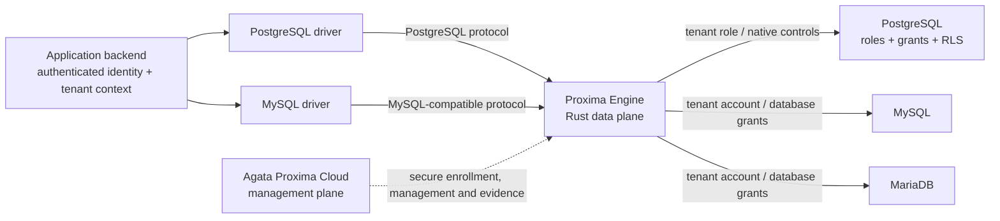

<p align="center">
  
</p>

<h1 align="center">Agata Proxima · Proxima Engine</h1>
<p align="center"><strong>Database security infrastructure for multi-tenant applications.</strong></p>
<p align="center">Proxima Engine is an open-source Rust database connection and enforcement layer. It sits between an application and its database, authenticates database sessions, binds each session to an authorized tenant identity and applies the controls appropriate to the selected database engine.</p>

<p align="center">
  <a href="https://github.com/Proxima-Engine/proxima-engine/actions/workflows/ci.yml">Continuous integration</a> ·
  <a href="LICENSE">MIT license for covered Engine source</a> ·
  <a href="https://agataproxima.com">Website</a> ·
  <a href="https://discord.gg/xsYSuDMzg">Discord</a> ·
  <a href="https://x.com/Worldtwins25">X</a> ·
  <a href="https://www.linkedin.com/company/agata-proxima/">LinkedIn</a>
</p>

**Explore:** [Platform overview](#platform-overview) · [Architecture](#architecture) · [Database support](#database-support) · [Quickstart](#quickstart) · [Security model](#security-model) · [Verification](#verification) · [Documentation map](#documentation-map)

**Engineering references:** [Architecture](docs/ARCHITECTURE.md) · [Tenant isolation](docs/TENANT_ISOLATION.md) · [Configuration](docs/CONFIGURATION.md) · [API and metrics](docs/API.md) · [Deployment](docs/DEPLOYMENT.md) · [Operations](docs/OPERATIONS.md) · [Verification](docs/VERIFICATION.md)

---

## Platform overview

Agata Proxima is database security infrastructure for software that serves multiple customer organizations from shared or dedicated data environments. Its purpose is to make tenant identity an enforceable part of the database connection path instead of relying exclusively on application developers to remember every tenant filter and authorization check.

The platform is designed as a database security layer that can expand across database systems. Each database adapter must preserve that platform-level model while implementing its own protocol handling, authentication, upstream identity mapping, native permission strategy and real-database verification.

The product has three connected responsibilities:

1. **Enforce** — Proxima Engine authenticates database clients, binds connections to tenant identities and forwards operations using constrained upstream database identities.
2. **Manage** — Agata Proxima Cloud provides organization-scoped management for tenants, policies, Engine nodes, deployment workflows and operational records.
3. **Verify** — database-specific tests exercise allowed and prohibited operations against the actual protected path and retain evidence of the result.

The Engine is the runtime data plane. Cloud is the management plane. The application continues to own user authentication and trusted resolution of organization and tenant context.

## Architecture

An application keeps its existing database driver. The driver connects to the Proxima listener that speaks the database's protocol. Proxima validates the client identity and tenant binding, applies protocol-aware admission rules and connects to the configured upstream database with the tenant's least-privilege credentials.



The Cloud control channel is not the SQL traffic path. Application database traffic flows through the customer-operated Engine to the configured database. Cloud manages organization and operational state; it does not replace the Engine's runtime enforcement decision.

### Request lifecycle

1. The application authenticates the user or service using its existing identity system.
2. The trusted application backend resolves the organization and tenant the caller is authorized to use.
3. The application opens a connection to the appropriate Proxima protocol listener using its normal database driver.
4. The Engine authenticates the database client and resolves its permitted tenant identity.
5. The Engine binds the session to the assigned upstream identity and database target.
6. Protocol-specific admission and connection controls are applied before traffic is forwarded.
7. The upstream database applies its own privileges and security controls.
8. Verification exercises allowed and denied operations; operational records and signed evidence can be reviewed through the management workflow.

## Database support

The repository currently contains three database integrations. They are not one generic protocol implementation: PostgreSQL has its own listener, while MySQL and MariaDB use a MySQL-compatible listener. MySQL and MariaDB remain separate server targets with independent setup instructions and integration suites.

| Database | Engine implementation | Tenant enforcement model | Verification |
|---|---|---|---|
| **PostgreSQL** | Native PostgreSQL wire-protocol listener | Signed tenant context, tenant-to-role routing, least-privilege PostgreSQL roles and database-native grants/RLS | PostgreSQL integration, tenant-isolation, PgBouncer pooling and recovery tests |
| **MySQL** | MySQL-compatible gateway | Authenticated client identity, immutable tenant session, assigned database validation and tenant-specific upstream account/grants | Dedicated MySQL real-database integration suite; CI target: MySQL Server 8.0 |
| **MariaDB** | MySQL-compatible gateway | Authenticated client identity, immutable tenant session, assigned database validation and tenant-specific upstream account/grants | Dedicated MariaDB real-database integration suite; CI target: MariaDB Server 11.4 |

A passing test against one database does not prove another database is isolated. Each adapter has to be configured and verified against the actual database server and version being deployed.

### PostgreSQL

PostgreSQL is the reference integration. The Engine validates signed tenant context, maps the verified tenant to its configured upstream PostgreSQL role and works with PostgreSQL grants and Row-Level Security (RLS). The repository includes a local Compose workflow, driver examples, PgBouncer transaction-pooling coverage, negative access tests and recovery checks.

Start with the [PostgreSQL quickstart](docs/QUICKSTART.md), then read the [PostgreSQL documentation hub](docs/POSTGRESQL.md), [tenant isolation guide](docs/TENANT_ISOLATION.md) and [verification guide](docs/VERIFICATION.md).

### MySQL

The MySQL-compatible gateway authenticates clients against a protected identity registry, binds each session to one tenant principal, validates the assigned upstream database and connects with a tenant-specific least-privilege account. The MySQL guide covers server setup, database and account provisioning, client authentication, SQL admission, prepared statements, connection behavior, troubleshooting and real-database integration.

Start with the [MySQL gateway guide](docs/MYSQL.md). Authentication details are in [MySQL gateway authentication](docs/MYSQL_GATEWAY_AUTH.md).

### MariaDB

MariaDB uses the same MySQL-compatible client protocol gateway, but it has its own upstream service configuration, tenant database and account setup, compatibility notes and real-database integration suite. It is documented and tested separately from MySQL.

Start with the [MariaDB gateway guide](docs/MARIADB.md). Authentication details are in [MySQL gateway authentication](docs/MYSQL_GATEWAY_AUTH.md).

### Additional database systems

The platform architecture is intended to expand through explicit database adapters. A database should be described as supported only when its protocol implementation, identity model, enforcement behavior, compatibility scope and real-database acceptance suite are present. Development work or a roadmap entry is not equivalent to production support.

## Quickstart

The default local quickstart starts the PostgreSQL reference environment. Use the dedicated MySQL and MariaDB guides for those database targets.

### Requirements

- Git
- Docker Desktop or Docker Engine
- Docker Compose v2
- Rust toolchain for building and running the Engine directly

### Clone and start the reference environment

```bash
git clone https://github.com/Proxima-Engine/proxima-engine.git
cd proxima-engine
docker compose -f compose.dev.yaml up --build -d
```

Check the local health and status endpoints:

```bash
curl -fsS http://127.0.0.1:9090/healthz
curl -fsS http://127.0.0.1:9080/api/status
```

Windows PowerShell:

```powershell
Invoke-RestMethod http://127.0.0.1:9090/healthz
Invoke-RestMethod http://127.0.0.1:9080/api/status
```

Then follow the [quickstart](docs/QUICKSTART.md) to create a table, send a real SQL query through the Engine and PgBouncer, inspect metrics and stop the local stack. The Compose profile uses disposable local credentials and synthetic data.

### Start a database-specific integration

- PostgreSQL: [Quickstart](docs/QUICKSTART.md)
- MySQL: [MySQL guide](docs/MYSQL.md)
- MariaDB: [MariaDB guide](docs/MARIADB.md)

Do not reuse PostgreSQL configuration as a substitute for MySQL or MariaDB gateway configuration. Each database target has its own upstream connection, tenant identity and native permission requirements.

## Security model

Proxima is one layer in a larger application security design. The application remains responsible for authenticating users and resolving trusted tenant membership. Proxima enforces the database connection identity it has been configured to accept. The upstream database remains responsible for its own privilege checks and native security controls.

### Identity and tenant binding

- Tenant identity must come from trusted application or machine-authentication state, not an unchecked browser-supplied identifier.
- A database client must map to an explicitly configured tenant identity.
- A session must remain bound to its assigned tenant and upstream database.
- Missing, malformed, invalid or expired identity must fail according to the configured enforcement mode.
- Connection pooling must not leak one tenant's context or upstream identity into another tenant's session.

### Database-native controls

- PostgreSQL deployments should use separate runtime roles, least-privilege grants and RLS where appropriate.
- MySQL and MariaDB deployments should use tenant-specific upstream accounts, narrow database grants and explicit database selection.
- Schema owners, migration accounts and runtime accounts should be separate.
- Administrative and superuser credentials must not be used for ordinary tenant traffic.

### Transport and connection controls

The Engine includes protocol-specific startup handling, connection limits, upstream timeouts and configurable TLS requirements. Review the [security guide](docs/SECURITY.md), [configuration reference](docs/CONFIGURATION.md) and [deployment guide](docs/DEPLOYMENT.md) before exposing a listener to application traffic.

### Cloud connectivity

Agata Proxima Cloud is the hosted management product. It provides organization workflows, team and plan management, registered Engine nodes, deployment coordination, verification records and audit-oriented operations. An Engine node connects to Cloud through its enrolled identity and management channel.

Cloud is not a database proxy. The customer-operated Engine remains in the application-to-database path, and the upstream database remains in the customer's chosen environment. The Cloud application and its private source are separate from this open-source Engine repository; the MIT license here applies only to the material covered by this repository's license.

See [Engine and Cloud integration architecture](docs/CLOUD_CONTROL_PLANE.md) for the management model and contracts.

## Verification

Verification must exercise the actual Engine-to-database path. Unit tests, compilation, a healthy HTTP endpoint or a saved control-plane record do not by themselves prove tenant isolation in a deployed environment.

### PostgreSQL reference checks

The repository includes PostgreSQL-backed tenant tests and a dedicated [PgBouncer tenant-pool integration test](scripts/test-pgbouncer-pooling.sh). The documented scenarios include:

1. Tenant A authenticates and reads its own row.
2. Tenant B authenticates and reads its own row.
3. Cross-tenant reads are not visible.
4. Cross-tenant writes are rejected by PostgreSQL RLS.
5. Missing or invalid signed tenant context is rejected when enforcement is enabled.
6. Pooled backend connections remain separated by tenant role.

### MySQL and MariaDB checks

The MySQL-compatible gateway has separate real-database integration suites. The tests cover tenant-local operations, cross-database read/write denial, database-switch denial, prepared statements and invalid client authentication. Run the relevant suite against the actual server type; do not infer MariaDB acceptance from MySQL results or vice versa.

### Workspace checks

```bash
cargo fmt --all -- --check
cargo check --workspace --all-targets
cargo test --workspace --all-targets
cargo clippy --workspace --all-targets --all-features -- -D warnings
```

Database-backed tests and deployed-environment acceptance have additional prerequisites. Follow [Verification](docs/VERIFICATION.md) and record the environment, database server/version, Engine build, test identities, expected and observed outcomes, skipped checks and evidence references.

## Cloud and customer-managed operations

The Engine can run on infrastructure controlled by the customer. Node registration and secure enrollment establish its identity with the management plane. The Engine reports signed health information, while the customer retains control of the host, network, database credentials, deployment mechanism and rollback policy.

The management workflow includes:

- Organization and team scope
- Tenant inventory and policy records
- Node registration, enrollment and lifecycle status
- Deployment intent and customer-managed execution callbacks
- Verification records and signed evidence
- Audit history and operational review

For exact enrollment and deployment behavior, use [Node enrollment](docs/NODE_ENROLLMENT.md), [Customer deployment executor](docs/CUSTOMER_DEPLOYMENT_EXECUTOR.md) and [Cloud integration architecture](docs/CLOUD_CONTROL_PLANE.md).

## Documentation map

| Area | Guide | What it covers |
|---|---|---|
| Product and architecture | [Architecture](docs/ARCHITECTURE.md) | Components, request lifecycle, identity and trust relationships |
| PostgreSQL | [PostgreSQL hub](docs/POSTGRESQL.md) | Reference setup, tenant roles, RLS, drivers, pooling and verification |
| PostgreSQL quickstart | [Quickstart](docs/QUICKSTART.md) | Local stack, first SQL request and health/metrics |
| MySQL | [MySQL gateway](docs/MYSQL.md) | MySQL setup, identity registry, accounts, protocol and integration tests |
| MariaDB | [MariaDB gateway](docs/MARIADB.md) | MariaDB setup, identity registry, accounts, protocol and integration tests |
| MySQL-compatible authentication | [Gateway authentication](docs/MYSQL_GATEWAY_AUTH.md) | Client verifier formats and authentication behavior |
| Tenant isolation | [Tenant isolation](docs/TENANT_ISOLATION.md) | Tenant context, roles, grants, RLS and positive/negative tests |
| Configuration | [Configuration](docs/CONFIGURATION.md) | Environment variables, defaults and validation |
| Local development | [Local development](docs/LOCAL_DEVELOPMENT.md) | Local node identity and signed test tokens |
| Engine CLI | [CLI](docs/CLI.md) | Bootstrap, token generation, diagnostics and local status |
| Driver integration | [Integrations](docs/INTEGRATIONS.md) | PostgreSQL driver examples for psql, Node.js, Python and Rust |
| API and monitoring | [API](docs/API.md) | Health, status and Prometheus metrics |
| Deployment | [Deployment](docs/DEPLOYMENT.md) | Images, TLS, networking, persistence and rollout |
| Node lifecycle | [Node enrollment](docs/NODE_ENROLLMENT.md) | Enrollment, identity persistence and management connectivity |
| Customer deployment | [Deployment executor](docs/CUSTOMER_DEPLOYMENT_EXECUTOR.md) | Signed events, executor credentials, allowlists and rollback |
| Operations | [Operations](docs/OPERATIONS.md) | Logs, health, metrics, restart and recovery |
| Security | [Security](docs/SECURITY.md) | Threat assumptions and required runtime controls |
| Verification | [Verification](docs/VERIFICATION.md) | Test suites, database-backed checks and evidence |
| Cloud integration | [Cloud architecture](docs/CLOUD_CONTROL_PLANE.md) | Management plane and Engine responsibilities |
| Open-source scope | [Open-source scope](docs/OPEN_SOURCE_SCOPE.md) | Licensed code, self-managed use and support |
| Contribution | [Contributing](CONTRIBUTING.md) | Local setup, code review and pull requests |
| Security reporting | [Security policy](SECURITY.md) | Private vulnerability reporting |
| Copyright | [Copyright and brand](COPYRIGHT.md) | Source-license and brand-asset boundaries |

## Repository layout

- `crates/proxima-engine/` — Rust Engine implementation and database protocol gateways.
- `crates/proxima-control-plane/` — public control-plane-related components and contracts present in this repository.
- `docs/` — architecture, database guides, configuration, deployment, security and operations.
- `scripts/` — local development, integration and verification scripts.
- `evidence/` — recorded engineering validation outputs.
- `compose.dev.yaml` — local PostgreSQL reference environment.
- `compose.customer.yaml` — customer-managed Engine deployment profile.

Use the documentation index at [docs/README.md](docs/README.md) to navigate the full guide set.

## Open-source scope and licensing

The Proxima Engine source and covered documentation are distributed under the [MIT License](LICENSE). The hosted Agata Proxima Cloud application, hosted account workflows and private management source are separate products and are not included in this repository's license. The Agata Proxima name, orbit logo and designated brand artwork are reserved assets; see [Copyright and brand](COPYRIGHT.md).

## Contributing and support

Use [GitHub Issues](https://github.com/Proxima-Engine/proxima-engine/issues) for reproducible Engine bugs and feature requests. Read [Contributing](CONTRIBUTING.md) before submitting a pull request. For security vulnerabilities, use the private reporting process in [SECURITY.md](SECURITY.md).

- Website: [agataproxima.com](https://agataproxima.com)
- Community: [Discord](https://discord.gg/xsYSuDMzg)
- Security: [SECURITY.md](SECURITY.md)
- Support: [support@agataproxima.com](mailto:support@agataproxima.com)

<p align="center">Built by Agata Proxima · <a href="https://agataproxima.com">agataproxima.com</a> · <a href="https://github.com/Proxima-Engine">GitHub organization</a></p>
