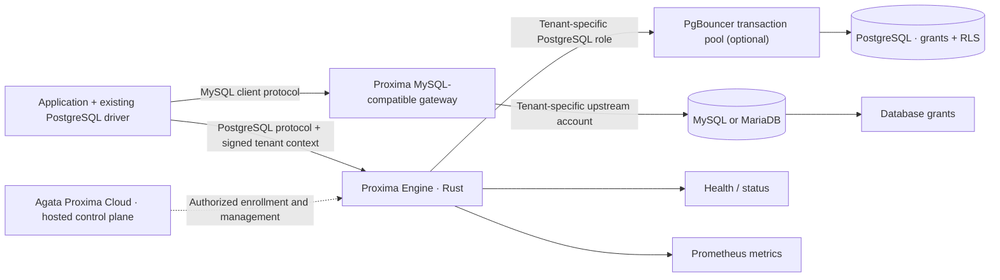

<h1 align="center">Agata Proxima · Proxima Engine</h1>

<strong>Multi-database tenant isolation, enforced at the database connection boundary.</strong>

Proxima Engine is the open-source Rust data plane for multi-database tenant security. It supports PostgreSQL, CockroachDB 25.2+, MySQL, MariaDB, MongoDB 8, Redis RESP2, SQLite tenant-file isolation, Oracle schema-per-tenant isolation, DynamoDB IAM LeadingKeys isolation, Cassandra keyspace-per-tenant isolation, and SQL Server's native database-per-tenant profile. Each database uses an isolation model appropriate to its architecture; these integrations are not presented as one interchangeable database protocol.

  <a href="https://github.com/Proxima-Engine/proxima-engine/actions/workflows/ci.yml">Continuous integration</a> ·
  <a href="https://github.com/Proxima-Engine/proxima-engine/blob/main/LICENSE">MIT License</a>

## What Proxima Engine provides

The Engine provides:

- **PostgreSQL signed-context enforcement.** Validates tenant tokens using HMAC-SHA256, including token format, tenant identifier, expiry and signature. Missing or invalid context is rejected when tenant enforcement is enabled.
- **PostgreSQL role routing.** Maps the verified tenant identity to its dedicated upstream PostgreSQL role and relies on PostgreSQL grants and Row-Level Security (RLS).
- **MySQL and MariaDB session binding.** Authenticates the client against a protected identity registry, binds the session to one tenant principal, validates the assigned upstream database and uses a dedicated least-privilege upstream account.
- **MySQL and MariaDB enforcement.** The MySQL-compatible gateway has separate MySQL and MariaDB integration suites.
- **CockroachDB compatibility.** Reuses the PostgreSQL wire gateway and requires CockroachDB-native forced row-level security, tenant-scoped roles, and least-privilege grants. The compatibility profile is verified against CockroachDB 25.2.
- **MongoDB restricted gateway.** Provides a separate OP_MSG gateway with SCRAM-SHA-256 authentication, TLS, database-per-tenant identity mapping, a narrow command allowlist, and tenant-bound sessions. Unsupported commands, transactions, sharded topologies, compression, and full MongoDB feature parity are not claimed.
- **Redis restricted gateway (preview).** Adds a separate RESP2 TLS listener, client identity registry, immutable tenant sessions, key namespace rewriting and per-tenant upstream Redis ACL users. RESP3, transactions, scripting, Pub/Sub, key scans and broad command compatibility are deliberately unsupported; the CI acceptance suite is the release gate.
- **SQL Server native tenant profile (preview).** Uses a dedicated SQL Server database and least-privilege login per tenant. It is not a Proxima TDS listener or shared-database RLS implementation.
- **SQLite tenant storage.** Uses a separate embedded SQLite database file per tenant, validated tenant identifiers, canonicalized storage paths, symlink rejection, owner-only Unix permissions, SQLite NOFOLLOW, WAL mode, and hardened connection pragmas.
- **Oracle schema tenancy.** Uses a dedicated Oracle schema owner per tenant, a bounded tablespace quota, narrowly scoped object-creation privileges, and no DBA or cross-schema ANY grants.
- **DynamoDB tenant authorization.** Generates tenant-specific AWS IAM identity policies scoped to an exact table ARN and authenticated tenant partition key through `dynamodb:LeadingKeys`. Scan, PartiQL, transactions and table administration are not granted. AWS IAM enforcement requires a real AWS-account acceptance test; DynamoDB Local cannot prove IAM isolation.
- **Cassandra tenant isolation.** Provides a keyspace-per-tenant provisioning profile with a dedicated login role and SELECT/MODIFY-only grants. It relies on Cassandra-native authentication and authorization; it is not a CQL wire-protocol proxy.
- **Protocol and connection controls.** Applies protocol-specific startup handling, connection limits, upstream timeouts and configured TLS requirements.
- **PostgreSQL security operations.** Includes the peer-scoped violation breaker, short-lived break-glass tokens with replay protection and the local signed attestation ledger.
- **PostgreSQL operational visibility.** Exposes the Engine's local health/status routes and Prometheus metrics.
- **Developer tooling.** Includes a Python local-development CLI, local identity bootstrap, signed PostgreSQL tenant-token generation, driver examples, database-specific guides, customer installers and integration tests.

### Agata Proxima Cloud — hosted management product

Agata Proxima Cloud is the separate hosted control plane for organization workflows, teams, plans, billing, registered nodes, and hosted management. It coordinates authorized Engine nodes while database traffic remains in the customer environment.

The Cloud application and its private source are separate from this public Engine repository. The MIT license in this repository applies to the material covered by its license; it does not grant access to the hosted application's source code or hosted account features.

## How the request path works

Proxima Engine works alongside existing database deployments and drivers. PostgreSQL and CockroachDB sessions use the PostgreSQL wire listener, tenant-scoped roles and database-native RLS. MySQL and MariaDB sessions authenticate through the MySQL-compatible listener and remain bound to the tenant's assigned database and least-privilege upstream account. MongoDB sessions use the restricted OP_MSG gateway and a tenant-specific database identity. Redis preview sessions use the RESP2 gateway and tenant key namespaces backed by Redis ACLs. SQL Server preview deployments use distinct database logins and databases per tenant. DynamoDB uses AWS IAM policy generation, while Cassandra uses native keyspace and role provisioning. Application authentication and organization membership checks remain in the trusted application backend.

## Database guides — separate setup for each engine

Each database has its own implementation guide, setup sequence, configuration, compatibility notes and verification instructions.

| Database | Start here | Deep-dive documentation |
|---|---|---|
| **PostgreSQL** | [PostgreSQL quickstart](docs/QUICKSTART.md) | [PostgreSQL documentation hub](docs/POSTGRESQL.md) · [Tenant isolation and RLS](docs/TENANT_ISOLATION.md) · [Driver integrations](docs/INTEGRATIONS.md) · [PgBouncer and verification](docs/VERIFICATION.md) |
| **MySQL** | [MySQL gateway guide](docs/MYSQL.md) | [Client authentication](docs/MYSQL_GATEWAY_AUTH.md) · [MySQL integration test](crates/proxima-engine/tests/mysql_gateway_integration.rs) |
| **MariaDB** | [MariaDB gateway guide](docs/MARIADB.md) | [Client authentication](docs/MYSQL_GATEWAY_AUTH.md) · [MariaDB integration test](crates/proxima-engine/tests/mariadb_gateway_integration.rs) |
| **CockroachDB 25.2+** | [Compatibility profile](docs/COCKROACHDB_COMPATIBILITY.md) | [Real CockroachDB tenant-isolation acceptance script](scripts/test-cockroachdb-tenant-isolation-ci.sh) |
| **MongoDB 8** | [Restricted gateway guide](docs/MONGODB_TENANT_ISOLATION.md) | [MongoDB gateway source](crates/proxima-engine/src/mongodb_gateway.rs) · [Real MongoDB tenant-isolation acceptance test](crates/proxima-engine/tests/mongodb_tenant_isolation.rs) |
| **Redis 7.4+ (preview)** | [Redis tenant gateway](docs/REDIS_TENANT_GATEWAY.md) | [RESP2 policy source](crates/proxima-engine/src/redis_protocol.rs) · [TLS gateway source](crates/proxima-engine/src/redis_gateway.rs) · [Real Redis acceptance script](scripts/test-redis-tenant-gateway-ci.sh) |
| **SQL Server 2022 (native profile preview)** | [Native tenant isolation](docs/SQLSERVER_NATIVE_TENANCY.md) | [Two-tenant provisioning fixture](scripts/sqlserver-provision-two-tenants.sql) · [Real SQL Server acceptance script](scripts/test-sqlserver-tenant-isolation-ci.sh) · No Proxima TDS proxy |
| **SQLite** | [Tenant isolation](docs/SQLITE_TENANCY.md) | Embedded database-file-per-tenant storage with path validation and owner-only permissions |
| **Oracle Database** | [Tenant isolation](docs/ORACLE_TENANCY.md) | Schema-per-tenant with dedicated Oracle users, bounded quota and least-privilege grants |
| **Amazon DynamoDB** | [Tenant isolation](docs/DYNAMODB_TENANCY.md) | Tenant-scoped AWS IAM policy using exact table ARN and `dynamodb:LeadingKeys`; AWS IAM acceptance requires an AWS test account |
| **Apache Cassandra 5** | [Tenant isolation](docs/CASSANDRA_TENANCY.md) | Dedicated keyspace and login role per tenant with SELECT/MODIFY-only grants; Cassandra acceptance script |

### What is a database gateway?

A database gateway is a protocol-aware network service between an application and its database. The application continues using its normal database driver. The driver connects to the matching Proxima listener; Proxima authenticates the connection, binds it to one tenant identity and forwards it to the assigned upstream database using that tenant's credentials.

The gateway does not replace a database engine or make different database security features interchangeable. PostgreSQL and CockroachDB use the PostgreSQL wire listener with their own native roles and RLS behavior. MySQL and MariaDB use the MySQL-compatible listener, tenant-specific upstream accounts and database grants. MongoDB uses a separate restricted OP_MSG gateway and MongoDB RBAC. Redis preview uses a RESP2 gateway, command allowlisting, tenant key namespaces and upstream ACL users. SQL Server preview uses native database-per-tenant logins and permissions; it is not a Proxima wire-protocol gateway.

## Security and verification boundaries

CI acceptance tests exercise the integrations that can be tested with disposable database services. DynamoDB's generated policy structure is unit-tested, but AWS IAM enforcement must be validated in a real AWS test account with separate tenant identities. Cassandra CI uses a disposable Cassandra 5 service with native password authentication and authorization. Production acceptance, cloud IAM verification, and workload-scale testing remain deployment-owner responsibilities.

## License

Proxima Engine is distributed under the MIT License. See [LICENSE](LICENSE).
