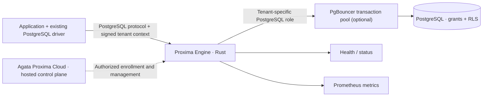

<p align="center">
  
</p>

<h1 align="center">Agata Proxima</h1>
<p align="center"><strong>Security infrastructure for multi-tenant PostgreSQL applications.</strong></p>
<p align="center">Proxima Engine is a Rust PostgreSQL-protocol gateway that verifies signed tenant context and routes each database session to its tenant-specific PostgreSQL role.</p>

<p align="center">
  <a href="https://github.com/Agata-Proxima/proxima-engine/actions/workflows/ci.yml">Continuous integration</a> ·
  <a href="LICENSE">MIT license for covered Engine source</a> ·
  <a href="https://agataproxima.com">Website</a> ·
  <a href="https://discord.gg/xsYSuDMzg">Discord</a> ·
  <a href="https://x.com/Worldtwins25">X</a> ·
  <a href="https://www.linkedin.com/company/agata-proxima/">LinkedIn</a>
</p>

**Start:** [What is Agata Proxima?](#what-is-agata-proxima) · [Customer Docker install](docs/NODE_ENROLLMENT.md#2-one-command-docker-installation-hosted-cloud) · [Guided customer install (Windows/Linux)](docs/CUSTOMER_DEPLOYMENT_EXECUTOR.md#install-the-engine-customer-node) · [Deployment executor](docs/CUSTOMER_DEPLOYMENT_EXECUTOR.md) · [Launch evaluation](docs/LAUNCH.md) · [Quickstart](docs/QUICKSTART.md) · [Local developer mode](docs/LOCAL_DEVELOPMENT.md) · [Engine CLI](docs/CLI.md) · [Documentation index](docs/README.md)

**Technical guides:** [Architecture](docs/ARCHITECTURE.md) · [Tenant isolation](docs/TENANT_ISOLATION.md) · [Driver integrations](docs/INTEGRATIONS.md) · [API and metrics](docs/API.md) · [Security](docs/SECURITY.md) · [Deployment](docs/DEPLOYMENT.md) · [Verification](docs/VERIFICATION.md)


## Watch: Zero-Trust Tenant Isolation in Action

**Proxima Engine enforces tenant identity at the PostgreSQL proxy boundary.** This recorded engineering demonstration shows the Engine under real database and connection-pooling conditions.

The walkthrough covers PgBouncer transaction pooling, deliberately misconfigured Row-Level Security scenarios, 1,000 distinct tenant identities with up to 50 concurrent clients, signed-token validation, and Engine recovery.

**Watch the full demonstration:**

https://github.com/user-attachments/assets/bca488eb-829c-4672-bbe9-b25878e5401c

**Read the engineering case study:** [Tenant isolation, PgBouncer pooling, 1,000-identity validation, RLS scenarios, and Engine recovery](docs/ENGINEERING_CASE_STUDY.md) · [Recorded validation evidence](evidence/engineering-validation-2026-11-09.md)

---

## What is Agata Proxima?

Agata Proxima provides security infrastructure for applications that serve multiple customers from a shared PostgreSQL environment. Its core job is to make tenant identity part of the database connection boundary and route each verified tenant session to a dedicated PostgreSQL role.

The product has two cooperating components:

### Proxima Engine — public, open-source data plane

Proxima Engine is a Rust service that sits between an application's existing PostgreSQL driver and PostgreSQL. It speaks the PostgreSQL wire protocol, so applications keep their existing database drivers and connect to the Engine endpoint.

The Engine provides:

- **Signed tenant-context verification.** Validates tenant tokens using HMAC-SHA256, including token format, tenant identifier, expiry, and signature. Missing or invalid context is rejected when tenant enforcement is enabled.
- **Tenant-to-role routing.** Maps the verified tenant identity to a configured PostgreSQL role and establishes a tenant-bound upstream database session.
- **PostgreSQL-native enforcement.** Works with database roles, grants, and Row-Level Security (RLS), keeping data authorization inside PostgreSQL.
- **Protocol and connection controls.** Handles PostgreSQL startup and authentication negotiation, connection limits, upstream timeouts, and configurable client/upstream TLS.
- **Security operations.** Includes a peer-scoped violation breaker, short-lived break-glass tokens with replay protection, and a local signed attestation ledger.
- **Operational visibility.** Exposes local health and status routes plus Prometheus metrics.
- **Developer tooling.** Includes a Python standard-library CLI, local identity bootstrap, tenant-token generation, integration examples, and repeatable PostgreSQL tests.

### Agata Proxima Cloud — hosted management product

Agata Proxima Cloud is the separate hosted control plane for organization workflows, teams, plans, billing, registered nodes, and hosted management. It coordinates authorized Engine nodes while database traffic remains in the customer environment.

The Cloud application and its private source are separate from this public Engine repository. The MIT license in this repository applies to the material covered by its license; it does not grant access to the hosted application's source code or hosted account features.

## How the request path works



Proxima Engine extends an existing PostgreSQL deployment: it verifies tenant context and selects the database role, while PostgreSQL privileges and RLS policies enforce which rows that role can read or modify. Application authentication and tenant authorization remain in the trusted application backend that issues signed tenant tokens.

## Get started

Requirements: Git and Docker with Compose.

```bash
git clone https://github.com/Agata-Proxima/proxima-engine.git
cd proxima-engine
docker compose -f compose.dev.yaml up --build -d
```

The local profile starts PostgreSQL, PgBouncer in transaction-pooling mode, and Proxima Engine. Check the local listeners:

```bash
curl -fsS http://127.0.0.1:9090/healthz
curl -fsS http://127.0.0.1:9080/api/status
```

Windows PowerShell:

```powershell
Invoke-RestMethod http://127.0.0.1:9090/healthz
Invoke-RestMethod http://127.0.0.1:9080/api/status
```

Then follow the [Quickstart](docs/QUICKSTART.md) to create a table, send a real SQL query through the Engine and PgBouncer, inspect metrics, and stop the local stack. The Compose profile uses disposable local credentials and synthetic data.

## Verify tenant isolation

The repository includes PostgreSQL-backed tenant tests and a dedicated [PgBouncer tenant-pool integration test](scripts/test-pgbouncer-pooling.sh), which is run by GitHub Actions.

The verification path covers:

1. Tenant A authenticates and reads only Tenant A's row.
2. Tenant B authenticates and reads only Tenant B's row.
3. Cross-tenant reads return zero visible rows.
4. Cross-tenant writes are rejected by PostgreSQL RLS.
5. Missing or invalid signed tenant context is rejected when enforcement is enabled.
6. Five sequential connections per tenant reuse that tenant role's backend PID, while the two tenant roles use separate backend PIDs through PgBouncer transaction pooling.

See [Tenant isolation](docs/TENANT_ISOLATION.md), [Verification](docs/VERIFICATION.md), and the [recorded PgBouncer transaction-pooling evidence](evidence/pgbouncer-transaction-pooling.txt).

## Documentation

| Guide | Purpose |
|---|---|
| [Quickstart](docs/QUICKSTART.md) | Start the local stack and query PostgreSQL through the Engine |
| [Local developer mode](docs/LOCAL_DEVELOPMENT.md) | Generate local node identity and signed tenant test tokens |
| [Engine CLI](docs/CLI.md) | Bootstrap, token generation, diagnostics, and local status commands |
| [Architecture](docs/ARCHITECTURE.md) | Request lifecycle, tenant context, source map, and control-plane boundary |
| [Configuration](docs/CONFIGURATION.md) | Environment variables, defaults, and validation |
| [Tenant isolation](docs/TENANT_ISOLATION.md) | PostgreSQL roles, RLS policies, signed context, and test results |
| [Driver integrations](docs/INTEGRATIONS.md) | psql, Node.js, Python, and Rust connection examples |
| [API reference](docs/API.md) | PostgreSQL endpoint, health/status routes, and Prometheus metrics |
| [Node enrollment](docs/NODE_ENROLLMENT.md) | Customer Docker installation, one-time enrollment, signed heartbeat, and identity persistence |
| [Customer deployment executor](docs/CUSTOMER_DEPLOYMENT_EXECUTOR.md) | Install and operate the customer-managed, signed Docker Compose deployment executor |
| [Deployment](docs/DEPLOYMENT.md) | Container build, TLS, networking, persistence, and deployment configuration |
| [Operations](docs/OPERATIONS.md) | Health checks, logs, monitoring, recovery, and troubleshooting |
| [Engineering case study](docs/ENGINEERING_CASE_STUDY.md) | Executed tenant-isolation, RLS, PgBouncer, concurrency, authentication, and recovery results |
| [Verification](docs/VERIFICATION.md) | Rust tests, PostgreSQL integration tests, CI, and evidence verification |
| [Security model](docs/SECURITY.md) | Implemented controls and the configuration required to operate them |
| [Developer security walkthrough](docs/DEVELOPER_SECURITY_DEMO.md) | Reproduce positive and negative tenant-access scenarios |
| [Cloud control plane](docs/CLOUD_CONTROL_PLANE.md) | Hosted product and self-managed Engine responsibilities |
| [Plans and billing](docs/BILLING.md) | Hosted plan and checkout information |
| [Support](docs/SUPPORT.md) | Technical support, issue reporting, and contact routes |
| [Contributing](CONTRIBUTING.md) | Development setup and pull-request process |
| [Security policy](SECURITY.md) | Private vulnerability reporting |
| [Code of Conduct](CODE_OF_CONDUCT.md) | Community participation standards |
| [Copyright and brand](COPYRIGHT.md) | Source-license and brand-asset boundaries |
| [Open-source scope](docs/OPEN_SOURCE_SCOPE.md) | MIT-licensed source, self-managed use, and support boundaries |

## Hosted product and contact

- **Website and hosted account:** [agataproxima.com](https://agataproxima.com)
- **Plans and billing:** [Hosted plan information](docs/BILLING.md)
- **Support:** [support@agataproxima.com](mailto:support@agataproxima.com)
- **Security reports:** [Private vulnerability reporting instructions](SECURITY.md)
- **Community:** [Discord](https://discord.gg/xsYSuDMzg)

## Open-source scope

The Proxima Engine source and covered documentation are distributed under the [MIT License](LICENSE). The hosted Cloud application, hosted account workflows, and private management source are separate products and are not included in this repository's license. The Agata Proxima name, orbit logo, and designated brand artwork are reserved brand assets; see [Copyright and brand](COPYRIGHT.md).

## Contribute

Use [GitHub Issues](https://github.com/Proxima-Engine/proxima-engine/issues) for reproducible Engine bugs and feature requests. Read [Contributing](CONTRIBUTING.md) before submitting a pull request. For vulnerabilities, use the private reporting process in [SECURITY.md](SECURITY.md).

<p align="center">Built by Agata Proxima · <a href="https://agataproxima.com">agataproxima.com</a> · <a href="https://github.com/Agata-Proxima">GitHub organization</a></p>

## Install a registered Engine node on Windows or Linux

The customer-node installer supports Windows 10/11 hosts running Docker Desktop with the WSL 2 backend, Linux containers, and Docker Compose v2. Windows users have a dedicated PowerShell installer; Linux users have a Bash installer. Both install the same Proxima Engine container and use the same signed enrollment and heartbeat protocol.

### Windows downloads

1. Download the [Proxima Engine source ZIP](https://github.com/Proxima-Engine/proxima-engine/archive/refs/heads/main.zip) and extract it.
2. In Agata Proxima Cloud → Nodes, copy the Windows PowerShell setup commands shown with the node's one-time enrollment token.
3. Keep the included [Windows PowerShell installer](https://raw.githubusercontent.com/Proxima-Engine/proxima-engine/main/install-customer.ps1) and [customer Compose file](https://raw.githubusercontent.com/Proxima-Engine/proxima-engine/main/compose.customer.yaml) together in the extracted repository folder.
4. Paste the copied setup commands into the same PowerShell session. The installer generates `.env` and `secrets/node_enrollment_token`; it prompts for the PostgreSQL upstream address if it is not set. No tenant signing key download is required.

### Windows prerequisites

- Windows 10/11 with Docker Desktop configured to use the WSL 2 backend and Linux containers.
- Docker daemon running before installation.
- The Windows setup commands copied from the registered node in Node Management.
- Network access from the Engine container to the configured PostgreSQL upstream and Agata Proxima HTTPS enrollment/heartbeat endpoints.

The Engine is distributed as a Linux container. On Windows, Docker Desktop runs that container through its Linux/WSL 2 backend; this is the supported Windows installation path. The PowerShell installer is a Windows host installer, not an MSI and not a native Windows service binary.

### Run the Windows installer

Open PowerShell in the extracted folder. If the machine's execution policy blocks a locally downloaded script, allow it for this PowerShell process only:

```powershell
Set-ExecutionPolicy -Scope Process -ExecutionPolicy Bypass
.\install-customer.ps1
```

The installer performs these checks and actions in order:

1. Generates the node environment file and one-time enrollment-token secret from the copied setup commands.
2. Prompts for the PostgreSQL upstream host and port when it is not already configured.
3. Confirms the Docker CLI and a running Docker daemon.
4. Confirms that Docker is using Linux containers and Docker Compose v2 is available.
5. Validates the customer Compose configuration.
6. Builds and starts the Engine container.
7. Waits up to 120 seconds for the container's Docker health check to report `healthy`.
8. Prints container status and the local PostgreSQL proxy endpoint.

A successful installation prints **Proxima Engine is healthy**. Then open Agata Proxima → Nodes/Fleet and confirm the registered node reports healthy after its signed heartbeat arrives. During first enrollment, the Control Plane returns the node heartbeat key and an organization-scoped tenant verification key over HTTPS. The Engine stores both in its protected identity file in a named Docker volume. The Control Plane master signing secret is never sent to customer nodes. After the node is healthy, replace the contents of `secrets/node_enrollment_token` with `enrollment-complete`; keep the file in place for subsequent Compose starts.

### Verify and operate on Windows

```powershell
docker compose -f compose.customer.yaml ps
docker compose -f compose.customer.yaml logs --tail 100 engine
$containerId = docker compose -f compose.customer.yaml ps -q engine
docker inspect --format '{{.State.Health.Status}}' $containerId
```

The final command prints the container health state. To verify SQL connectivity, connect your application or a PostgreSQL client to `127.0.0.1:6432` using the database credentials configured for your upstream PostgreSQL service.

Restart and stop the registered node:

```powershell
docker compose -f compose.customer.yaml restart engine
docker compose -f compose.customer.yaml down
```

Start it again without rebuilding:

```powershell
docker compose -f compose.customer.yaml up -d
```

### Linux installation

Linux customers copy the Linux shell setup commands from Agata Proxima → Nodes and paste them into a shell in the extracted repository folder. The Bash installer creates the environment and enrollment-token secret automatically:

```bash
chmod +x ./install-customer.sh
./install-customer.sh
```

For the Linux deployment-executor service installer and its security requirements, see [Customer-managed deployment executor](CUSTOMER_DEPLOYMENT_EXECUTOR.md).

### Network and security requirements

- The Engine listens on TCP 6432 and binds to host loopback by default. Keep this binding when the application runs on the same host.
- If the application runs in another container, attach it to the configured Compose network and use the Engine service name and port. For a different host, use a private network/VPN, a deliberate private bind address, and a restrictive firewall rule.
- The configured PostgreSQL upstream address is resolved from inside the Engine container. `localhost` refers to the container itself, not the Windows host. Use a reachable database hostname or the appropriate Docker Desktop host gateway address.
- Never expose PostgreSQL proxy port 6432, the status interface, or metrics publicly.
- Never commit, email, or paste `.env`, enrollment tokens, node identity files, operator API keys, or webhook secrets.
- The Control Plane master tenant-signing secret stays in the Control Plane. A customer Engine receives only its own organization's derived verification key during HTTPS enrollment; the Engine stores it in the protected identity file.
