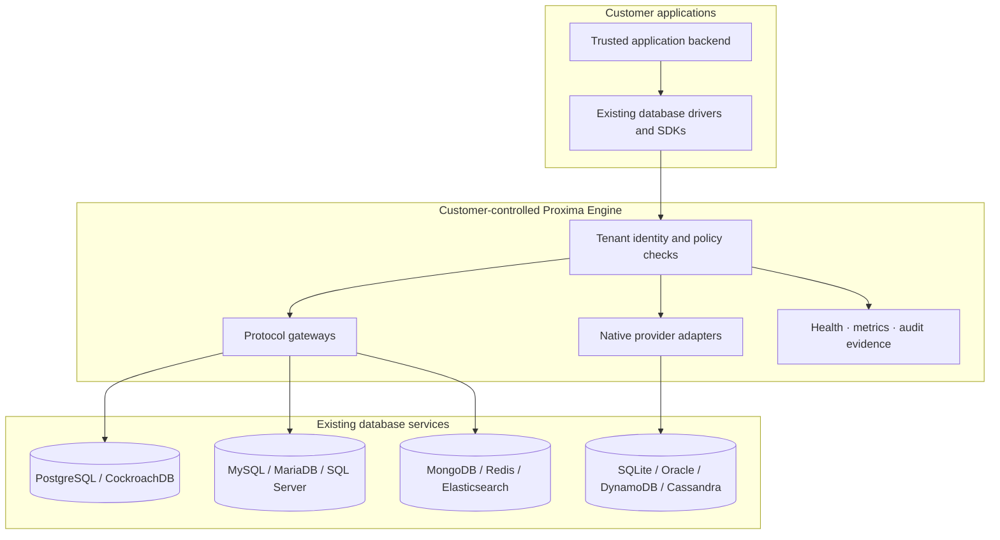
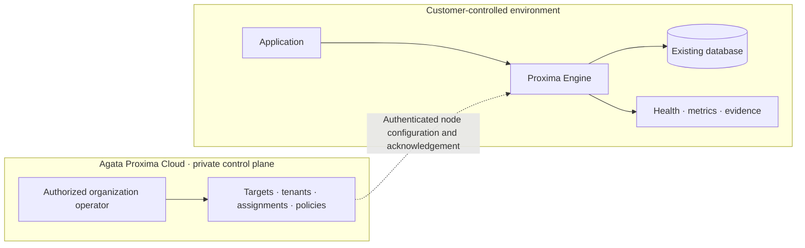

# Proxima Engine architecture

Proxima Engine is the customer-deployed Rust data plane for Agata Proxima. It connects applications to existing database services and applies provider-specific tenant identity and access boundaries. Customers keep their databases, application drivers and data.

The Engine supports twelve database systems through protocol gateways and native provider integrations. Each provider retains its own authentication, authorization and operational model; see the linked provider guide for its exact boundary and setup.

## Platform view

## Provider runtime models

| Provider group | Runtime path | Tenant boundary |
|---|---|---|
| PostgreSQL, CockroachDB | PostgreSQL wire gateway | Signed tenant context, tenant roles and database row-level policies |
| MySQL, MariaDB | MySQL protocol gateway | Authenticated tenant principal, fixed database mapping and restricted upstream account |
| MongoDB | OP_MSG gateway | SCRAM-SHA-256 principal bound to one tenant database |
| Redis | RESP2 gateway | Authenticated tenant principal, tenant key namespace and Redis ACL identity |
| Microsoft SQL Server | TDS 7.4 gateway | LOGIN7 principal bound to its assigned database and SQL Server login |
| SQLite | Native embedded module | Private database file per tenant, protected by filesystem and path controls |
| Oracle Database | Native provisioning module | Dedicated schema owner and least-privilege grants |
| Amazon DynamoDB | Native IAM policy integration | Exact table resource and tenant partition-key condition |
| Apache Cassandra | Native provisioning module | Keyspace-per-tenant role and restricted grants |
| Elasticsearch / OpenSearch | Native security API integration | Tenant index namespace and provider-native role permissions |

## Request and enforcement flow

1. The trusted application authenticates the user and resolves organization and tenant membership.
2. The trusted backend supplies the tenant identity through the provider's supported server-side connection or credential flow.
3. Engine validates the identity and selects the provider-specific tenant binding.
4. The protocol gateway or native adapter enforces the relevant namespace, identity, credential and permission boundary.
5. The database applies its own authorization controls as a second enforcement layer.
6. Engine reports runtime health, applied configuration and verification evidence through its configured operational channel.

A tenant identifier supplied by an untrusted browser or client is not proof of authorization. Tenant membership must be established by the trusted application backend.

## Control plane and data plane

Cloud coordinates authorized organization and node workflows. It is not in the database query path. Engine and the existing database enforce the customer data path inside the customer's environment. Cloud management documentation and source are maintained separately from this public Engine repository.

## Deployment shapes

- **Local development:** use the provider quickstart and disposable database fixtures.
- **Self-managed environment:** deploy Engine near the database, restrict listeners to private networks, store credentials in a secret manager and verify TLS across network boundaries.
- **Cloud-managed customer Engine:** enroll the customer-hosted node and assign provider targets through the authorized Cloud workspace. Database traffic remains between the application, Engine and customer database.

## Security and operations

- Derive tenant identity from trusted authentication, not client-supplied tenant labels.
- Use distinct tenant credentials and least-privilege provider roles.
- Keep gateway registries, certificates and private keys out of source control.
- Require verified TLS for remote database connections.
- Keep administrative and provisioning credentials separate from application credentials.
- Test cross-tenant read and write denial against disposable provider instances before production rollout.
- Monitor health, rejected requests, credential lifecycle and applied runtime revisions.

See [Security](SECURITY.md), [Tenant isolation](TENANT_ISOLATION.md), [Configuration](CONFIGURATION.md), [Operations](OPERATIONS.md), and [Provider runtime verification](PROVIDER_RUNTIME_REFERENCE.md).
