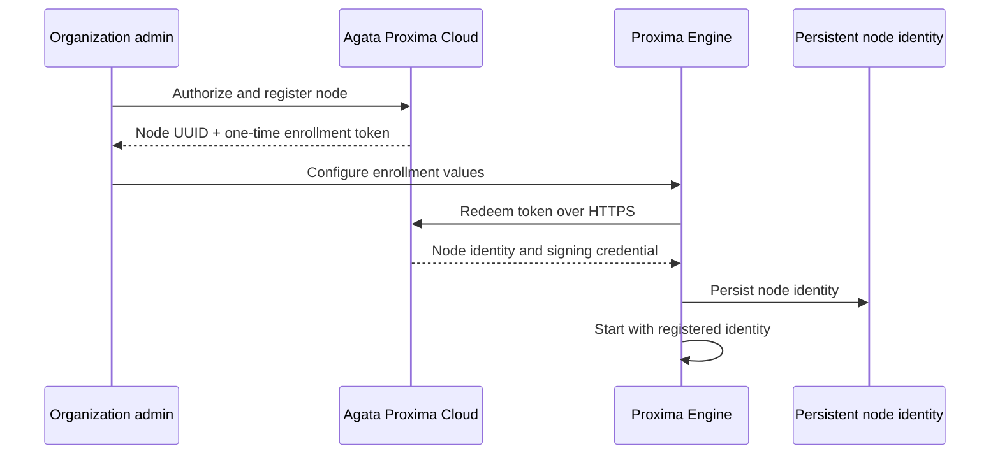

# Proxima Engine node identity and enrollment

This guide describes how a Proxima Engine node receives a registered identity from a compatible control plane, redeems a one-time enrollment token, and persists its signing credential for later starts.

## Enrollment flow



The hosted product authorizes organizations and issues registration credentials. The public repository implements the Engine-side enrollment request, response validation, and local identity persistence.

## Local developer identity and hosted enrollment

For offline local development, use [Local developer mode](LOCAL_DEVELOPMENT.md). It generates a self-issued local node identity and signed test tenant tokens without a Cloud account.

For a hosted registered identity, a compatible Agata Proxima control plane issues a node UUID and a short-lived one-time enrollment token. A self-managed deployment can use its own compatible control plane.

## 1. Obtain enrollment values

Start at [agataproxima.com](https://agataproxima.com) and use the authorized organization workflow to register a node and obtain:

- The registered node UUID.
- The HTTPS enrollment URL ending in `/api/v1/nodes/enroll`.
- The one-time enrollment token.

Keep the token in a protected terminal or secret store. Do not paste it into GitHub, screenshots, chat, logs, or public documentation.

Use HTTPS for remote control-plane hosts. Loopback HTTP is reserved for local development.

## 2. One-command Docker installation (hosted Cloud)

This is the recommended customer path. Docker Engine and Docker Compose v2 are required on the customer's host. Agata Proxima does not provision, own, or receive the customer's PostgreSQL credentials.

1. Register a node in Agata Proxima Cloud and download the three generated files from the registration result: .env, node_enrollment_token, and tenant_signing_key.
2. Download the public Engine repository ZIP and extract it on the customer host.
3. Place .env and compose.customer.yaml in the repository root. Create a secrets directory beside them and save the two secret downloads as secrets/node_enrollment_token and secrets/tenant_signing_key.
4. Set the upstream address in .env to the PostgreSQL host reachable from the Engine container. The tenant signing key must be the same secret the trusted application backend uses to sign tenant context. Never reuse the one-time enrollment token as the tenant signing key.
5. Start the Engine:

```bash
docker compose -f compose.customer.yaml up --build -d
docker compose -f compose.customer.yaml logs -f engine
```

The Compose file mounts the enrollment token and tenant signing key as read-only secret files. Neither secret is passed as a container environment variable. The Engine runs as UID 10001. On Linux, make the secret directory and files readable by that UID while keeping them private from other host users (for example, chown the directory and files to 10001:10001, chmod the directory 0700 and the files 0400). On Docker Desktop, confirm the mounted files are readable inside the Linux container; do not make the host secrets directory broadly readable just to work around a permission issue. The Engine reads the enrollment token file only during first enrollment, persists its node identity in the named Docker volume, and sends signed heartbeats every 30 seconds. No heartbeat cron job, custom webhook receiver, or customer-written enrollment code is required.

When Fleet shows the node as healthy, replace the contents of secrets/node_enrollment_token with the harmless text enrollment-complete. The persisted node identity is used on subsequent starts, so the consumed one-time token is no longer needed. Keep secrets/tenant_signing_key protected and persistent.

For PowerShell, use the same files and Docker Compose commands. The host directory containing .env and secrets must be accessible only to the customer operators who manage the Engine.

The Engine listens on port 6432. By default, the host port is bound to 127.0.0.1. If the application runs in another container, attach it to the shared proxima-engine-network and connect to engine:6432. Do not expose port 6432 publicly without a customer-controlled firewall rule. The upstream PostgreSQL address must be reachable from inside the Engine container; localhost means the container itself, not the host.

## 3. Configure the Engine — PowerShell

Replace the placeholders with the values issued for the node:

```powershell
$env:PROXIMA_NODE_ID = "<node-uuid>"
$env:PROXIMA_NODE_ENROLLMENT_URL = "https://<control-plane-host>/api/v1/nodes/enroll"
$env:PROXIMA_NODE_ENROLLMENT_TOKEN = "<one-time-token>"

$env:PROXIMA_LISTEN_ADDR = "127.0.0.1:6432"
$env:PROXIMA_UPSTREAM_ADDR = "127.0.0.1:5432"

cargo run -p proxima-engine
```

The Engine sends `POST /api/v1/nodes/enroll` with JSON fields `node_id` and `enrollment_token`. The control plane validates the one-time token and returns the node identity and signing credential. The Engine validates the response and persists the identity.

Remove the bootstrap token after enrollment:

```powershell
Remove-Item Env:PROXIMA_NODE_ENROLLMENT_TOKEN -ErrorAction SilentlyContinue
```

## 4. Configure the Engine — Bash

```bash
export PROXIMA_NODE_ID="<node-uuid>"
export PROXIMA_NODE_ENROLLMENT_URL="https://<control-plane-host>/api/v1/nodes/enroll"
export PROXIMA_NODE_ENROLLMENT_TOKEN="<one-time-token>"
export PROXIMA_LISTEN_ADDR="127.0.0.1:6432"
export PROXIMA_UPSTREAM_ADDR="127.0.0.1:5432"
cargo run -p proxima-engine
unset PROXIMA_NODE_ENROLLMENT_TOKEN
```

Set the values in the same process environment that starts the Engine. The Engine reads process environment variables; it does not automatically load a plain `.env` file.

## 5. Persist and protect the identity

Default identity paths:

- Windows: `%LOCALAPPDATA%\AgataProxima\node-identity.json`, when `LOCALAPPDATA` exists.
- Other environments: `data/node-identity.json`.

Set `PROXIMA_NODE_IDENTITY_PATH` to choose another path. The identity file contains the node ID, organization ID, and a 32-byte signing credential. Restrict file permissions and include the file in protected backups.

The Engine reuses a valid saved identity on later starts, so the one-time enrollment token is needed only for the initial bootstrap. Use a separate identity path for each node.

When the Engine has a registered node identity and a compatible heartbeat endpoint, it sends an HMAC-SHA256 signed liveness report every 30 seconds. The heartbeat uses the enrolled node signing key, is independent of the hourly attestation ledger, and does not assert tenant isolation. Fleet marks a node degraded after 90 seconds without a heartbeat and offline after five minutes. The control plane rejects stale, replayed, incorrectly signed, or revoked-node heartbeats.

## 6. Credential reference

| Variable or file | Purpose | Handling |
|---|---|---|
| `PROXIMA_NODE_ENROLLMENT_TOKEN` | One-time bootstrap credential | Short-lived; remove after enrollment |
| `PROXIMA_NODE_IDENTITY_PATH` | Persistent identity file | Contains a signing credential; protect it |
| `PROXIMA_NODE_SIGNING_KEY_HEX` | 32-byte node signing key, hex encoded | Normally loaded from saved identity; never commit |
| `PROXIMA_TENANT_SIGNING_KEY` | HMAC key for application-signed tenant context | Separate from node credentials; at least 32 bytes |
| `PROXIMA_ATTESTATION_INGEST_TOKEN` | Optional bearer credential for a compatible evidence receiver | Use the required `aga_` prefix; never commit |

These credentials serve different trust boundaries. Keep each in its designated configuration field and rotate it through the corresponding issuer.

## Troubleshooting

- **401 Unauthorized:** verify that the node UUID and one-time token belong together and that the token is valid and unused.
- **Connection refused or timeout:** check DNS, routing, firewall rules, and the configured enrollment URL.
- **TLS certificate error:** use the correct HTTPS hostname and a trusted certificate chain.
- **Identity file error:** check the path, JSON format, and read/write permissions.
- **Engine exits before listening:** inspect the startup error and verify all supplied enrollment values.

See [Configuration](CONFIGURATION.md), [Operations](OPERATIONS.md), [Customer deployment executor](CUSTOMER_DEPLOYMENT_EXECUTOR.md), and [Cloud control-plane boundary](CLOUD_CONTROL_PLANE.md).
